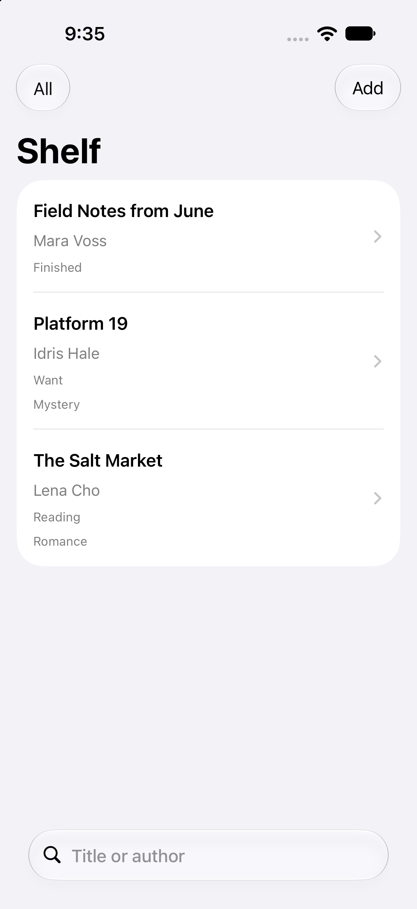
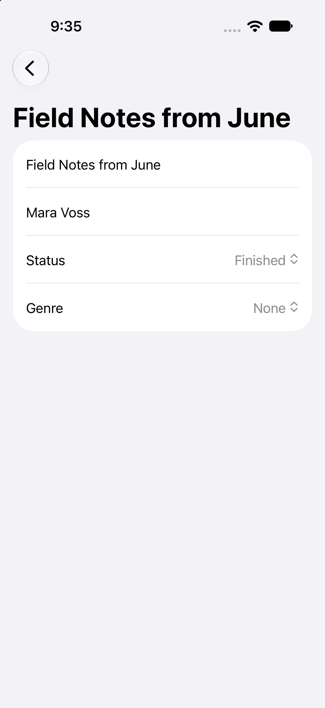
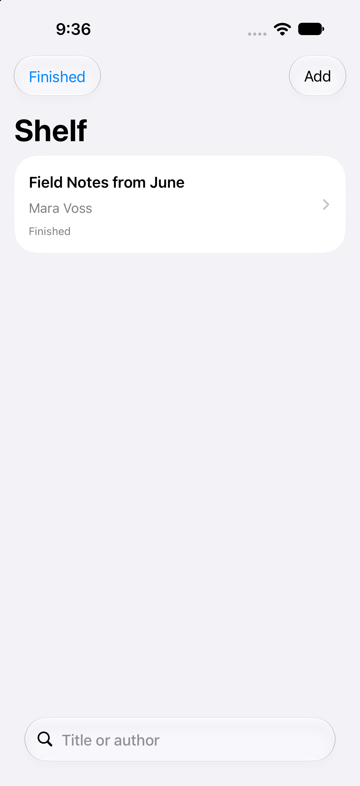

# Shelf

Shelf is a personal library for books you want to read, are reading, and have finished. The list stays on the device after the app quits. You can search by title or author and narrow the list by status.

## Run

1. Open `Shelf.xcodeproj` in Xcode 27 or later.
2. Choose an iPhone simulator.
3. Press Run.

The project uses Swift 6 and a deployment target of iOS 26. The first launch inserts three sample books when the store is empty.

## Decisions

### Book is a SwiftData model

`Book` is a class marked `@Model`, so SwiftData can update that one object and keep it after a relaunch. Status and genre stay enums. A book can only be want, reading, or finished, and a genre can only be one of the named cases or absent.

### Search and status share one predicate

`BookList` builds a single `#Predicate` in its initializer. The predicate keeps a book when the selected status matches, or when the filter is All, and when the search text is empty or appears in the title or author. The store applies that filter. The screen does not filter an already loaded array.

### Samples are inserted once

On appear, Shelf asks the store for `fetchCount` of `Book`. The three sample books are inserted only when that count is zero. The next launch finds the saved books and does not insert them again.

## Screens

The library:

A book open for editing:

The list narrowed by search or status:

## Layout

- `Shelf/` contains the SwiftUI screens and the `Book` model.
- `Shelf.xcodeproj` is the Xcode project.
- `Screenshots/` holds the three images above.
